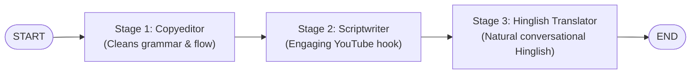

# Sequential AI Agent Pipeline with LangGraph & Groq

An agentic AI pipeline built with **[LangGraph](https://github.com/langchain-ai/langgraph)** and **[Groq](https://groq.com/)**. This project demonstrates a sequential multi-stage LLM workflow that transforms raw, unedited text into an engaging, localized Hinglish video script hook.

---

## Architecture & Workflow

The sequential pipeline processes content across three specialized agent nodes:



1. **Copyeditor Node (`editor_node`)**: Takes the raw input text, fixes grammatical errors, resolves typos, and refines flow while preserving the core message.
2. **Scriptwriter Node (`script_node`)**: Rewrites the polished text into an energetic, conversational YouTube video script hook.
3. **Hinglish Translator Node (`translator_node`)**: Localizes the script into natural-flowing "Hinglish" (a blend of Hindi and English) suitable for tech content creators and educators.

---

## Project Structure

```text
.
├── sequnatial_project.py   # Main LangGraph sequential workflow pipeline
├── states.py               # State schema definitions (TypedDict and Pydantic)
├── requirements.txt        # Python project dependencies
├── .env.example            # Environment variables template
├── .gitignore              # Files ignored by git (e.g., .env, .venv)
└── README.md               # Project documentation
```

---

## Getting Started

### 1. Prerequisites
- Python 3.10 or higher
- A free Groq API Key from [Groq Console](https://console.groq.com/keys)

### 2. Clone the Repository
```bash
git clone https://github.com/YOUR_USERNAME/YOUR_REPOSITORY.git
cd "agentic ai"
```

### 3. Set Up Virtual Environment
On Windows (PowerShell):
```powershell
python -m venv .venv
.\.venv\Scripts\Activate.ps1
```

On macOS / Linux:
```bash
python3 -m venv .venv
source .venv/bin/activate
```

### 4. Install Dependencies
```bash
pip install -r requirements.txt
```

### 5. Configure Environment Variables
Copy the `.env.example` file to create `.env`:
```bash
cp .env.example .env
```
*(On Windows PowerShell, use `Copy-Item .env.example .env`)*

Open `.env` and add your Groq API key:
```env
GROQ_API_KEY=your_groq_api_key_here
```

---

## Running the Pipeline

Run the sequential project script:
```bash
python sequnatial_project.py
```

### Example Input
```text
"AI agents are the future of tech. They can think, plan, and act on their own. LangGraph helps you build these agents with proper control and memory."
```

### Example Output
```text
--- [Stage 1] Executing Copyeditor Node ---

--- [Stage 2] Executing Scriptwriter Node ---

--- [Stage 3] Executing Hinglish Translator Node ---
अरे सुनो, अगर मैं कहूँ कि अगली टेक लहर सिर्फ स्मार्ट नहीं, बल्कि पूरी तरह से self‑driving है? हाँ, वही AI agents जो खुद सोचते, प्लान बनाते और एक्शन लेते हैं—वो हमारे सारे दिमागी फ्रेमवर्क को ही हिला देंगे। और यहाँ पर है असली मसाला: LangGraph! ये वो secret sauce है जो आपको ऐसे एजेंट्स बनाना सिखाता है जिनमें है rock‑solid control और memory...
```

---

## Tech Stack
- **Framework**: [LangGraph](https://github.com/langchain-ai/langgraph) & [LangChain](https://github.com/langchain-ai/langchain)
- **Inference Engine**: [Groq Cloud](https://groq.com/) (`ChatGroq`)
- **Data Validation**: [Pydantic](https://docs.pydantic.dev/) & `typing.TypedDict`
- **Environment Management**: `python-dotenv`
